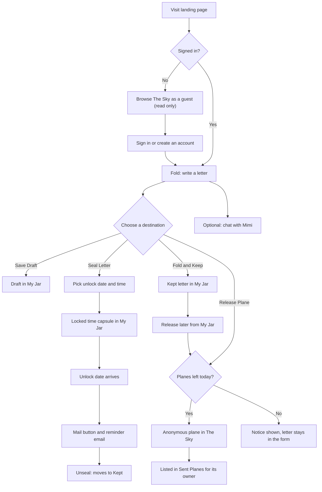

# Windup - Product Requirements Document

Status: aligned with the implemented codebase (October 2026).

This document describes what Windup does today. Where the product intentionally differs from earlier planning, or where a behavior is incomplete, it is called out in section 12 (Known limitations) and in `ROADMAP.md`.

## 1. Product summary

Windup is a quiet, letter-based journaling web app. A person writes a letter in the **Fold** page, then chooses where it goes:

- **Keep in My Jar** - save it privately on the Kept shelf.
- **Save as a draft** - keep an unfinished private letter to edit later.
- **Seal for Later** - lock it as a time capsule until a chosen date and time.
- **Release to The Sky** - publish it anonymously as a paper plane that other people can read and "resonate" with (like).

Windup is intentionally smaller and slower than typical social media. Writing is unlimited in count, but each account may release at most **3 public paper planes per day**. Mimi, an optional AI writing companion, is a small chat panel on the Fold page that helps a person start a letter. Mimi has a daily energy allowance of **10 messages per account**.

The product is built for personal reflection, not social interaction: there are no profiles, follows, comments, or direct messages.

## 2. Problem and opportunity

Many people have thoughts they want to write down without turning them into polished blog posts or permanent social-media updates. Some thoughts are only for the writer, some are meant for a future self, and some feel easier to share without an identity attached.

Windup gives these thoughts distinct homes. The paper-plane metaphor makes the public action feel deliberate instead of impulsive, and the daily limit keeps the Sky calm.

## 3. Target user

People who enjoy journaling, keep private notes, or want a gentle and anonymous way to share thoughts. Typical users are students, young adults, and anyone who wants a less noisy writing space.

The product does not target organizations, teams, paid creators, or a large social network.

## 4. Product goals

- Make it easy to write and save a private letter.
- Make future letters feel meaningful through sealing, unsealing, and reminder emails.
- Let people share anonymously without exposing email addresses, names, or account ids.
- Keep usage within beginner-friendly and free-tier-friendly limits through server-enforced daily quotas.
- Add a small, useful AI touch (Mimi) without making AI the whole product.

## 5. Terminology

| Term | Meaning |
| --- | --- |
| Letter / Thought | A single written entry. The database table is named `thoughts`; the UI says "letter". |
| Fold | The writing page, and the act of writing and filing a letter. |
| My Jar | The private library of drafts, kept letters, and sealed letters. |
| Kept | A private letter. Stored in the database with status `folded`. |
| Sealed | A private letter locked until its unlock date (a "time capsule"). |
| Released / Paper plane | A public, anonymous letter shown in The Sky. |
| The Sky | The public space where released planes drift. |
| Sent Planes | The owner's record of their own released planes. |
| Resonated | The public like count of a plane (shown as "Like" in The Sky, "Resonated" in Sent Planes). |
| Mail | The header button that lists sealed letters whose unlock date has arrived. |
| Energy | Mimi's daily message allowance, shown as a battery. |

## 6. Core experience

```text
Sign up with email and a single-word display name
      |
      v
Open Fold
      |
      v
Write a letter, optionally pick a mood, optionally chat with Mimi
      |
      v
Save draft / Fold and keep / Seal for later / Release to the Sky
      |
      v
Find it again in My Jar, Sent Planes, or The Sky
```

### User journey diagram



## 7. Information architecture

| Area | URL | Purpose | Who can see it |
| --- | --- | --- | --- |
| Landing | `/` | Welcome page with sign in, sign up, and a live plane counter | Everyone |
| Sign in | `/login` | Email and password sign in | Everyone |
| Sign up | `/signup` | Create an account | Everyone |
| Fold | `/fold` | Create or edit a letter; Mimi panel | Everyone can view; only signed-in users can save, seal, or release |
| My Jar | `/jar` | Private library of drafts, kept, and sealed letters | Owner only (guests are redirected to `/login`) |
| The Sky | `/sky` | Anonymous public planes | Everyone can read; only signed-in users can like |
| Sent Planes | `/sent-planes` | Owner's released planes and today's release count | Owner only (guests are redirected to `/login`) |
| Settings | `/settings` | Profile, data export, terms, privacy, support | Owner only (guests are redirected to `/login`) |

Global navigation (Navbar): Fold, My Jar, The Sky, Sent Planes, Settings, a Mail button, a light/dark theme toggle, and a profile menu with sign out. Guests see only The Sky, a "Guest Mode" badge, and a Sign In button. On small screens the links collapse into a menu.

## 8. Requirements as implemented

### 8.1 Account and authentication

- A visitor signs up and signs in with email and password through Supabase Auth.
- Sign-up fields: display name, email, password.
  - Display name: required, a single word with no spaces.
  - Email: required, must match a standard email pattern.
  - Password: required, at least 8 characters.
- Inline field errors appear after a field is touched and clear as soon as the value is valid. Friendly messages replace raw Supabase error codes (invalid credentials, unconfirmed email, existing account, weak password, rate limits).
- When Supabase requires email confirmation, sign-up shows a notice instead of signing the person in. The confirmation link lands on `/auth/callback`, which creates the session and redirects to `/jar`. An invalid or expired link redirects to `/login` with a clear message.
- Windup sends all authentication emails itself through a Supabase "Send Email" Auth Hook and Brevo, using branded templates (see `4_API_ROUTES.md`).
- The display name is stored in the Supabase user metadata (`display_name`), not in a separate profiles table. It follows the account across devices and can be changed in Settings.
- Signing out clears the locally cached profile and every account-scoped browser cache.
- The app never shows an email address to other users.
- Not implemented: a page to request or complete a password reset, and a way to change the account email.

### 8.2 Guest mode

Guests (no session) are read-only:

- They can read the landing page and every plane in The Sky.
- Trying to like, save, seal, or release opens a friendly "sign in" prompt instead of running the action.
- The Mimi panel shows a sign-in note instead of the chat input.
- My Jar, Sent Planes, and Settings redirect to `/login`.

### 8.3 Letter editor: Fold

- A signed-in user writes a letter with an optional title, a required body, and an optional mood.
- Title: up to 100 characters in the editor (the server and database allow 120). A letter saved without a title is named "Untitled Thought"; a draft without a title is named "Untitled Draft".
- Body: up to 1,000 words in the editor, with a live word counter. The server and database cap the body at 10,000 characters.
- Mood: one of six moods (section 8.9), default Neutral.
- Visibility selector with two options:
  - **Private (Jar)** - shows Save Draft, Seal Letter, and Fold and Keep.
  - **Anonymous Public (Sky)** - shows a "planes left today" badge and Release Plane. Save Draft and Seal Letter are hidden.
- When today's plane allowance is used up, the Release button is replaced by a calm notice ("Daily limit reached (3/3). Planes can fly again tomorrow.") and the letter stays in the editor.
- A save runs a short animation (fold, seal, fly, or draft pulse), shows a toast, clears the form, and redirects: released letters go to `/sky`, everything else goes to `/jar`.
- If saving fails, the animation is undone, the letter stays in the form, and an error toast explains what happened.
- A draft can be reopened with `/fold?draftId=<id>` from My Jar. Saving then updates the same row instead of creating a new one.
- Only drafts can be edited in the interface. Kept letters can be viewed, released, or deleted but not edited.

### 8.4 My Jar

- My Jar lists only the signed-in user's private letters (drafts, kept, sealed). Released planes appear in Sent Planes instead.
- The Memory Shelf filters: All Entries, Drafts, Kept, Sealed, each with a live count.
- Each card shows a mood badge, a status label, the title (or "Untitled Letter"), a three-line preview, the created date, and actions.
- Card actions: view, edit (drafts only), release (kept letters), unseal (sealed letters whose date has arrived), delete.
- Deleting asks for confirmation and cannot be undone. Releasing asks for confirmation and explains that the letter becomes anonymous and public.
- Changes appear instantly (optimistic updates). If the server refuses a change, the list is restored and an error dialog explains why.
- The header reads "{display name}'s Jar".
- The "Opened" status is no longer a separate shelf: an unsealed letter becomes a Kept letter.

### 8.5 Seal for Later (time capsules)

- Choosing Seal Letter opens a date and time picker. The default is tomorrow at 12:00. The chosen moment must be in the future.
- A sealed letter is shown in My Jar as locked: the card shows "Safely locked in the jar." and an "Unlocks" date instead of the letter text, and it cannot be opened.
- When the unlock moment arrives:
  - The card gains an amber highlight, the message "Your time capsule is ready to open.", and an **Unseal** button.
  - The **Mail** button in the header shows a dot and lists the ready capsules. The list updates against a live clock every 30 seconds and reloads on every page change.
  - A daily cron job emails the owner a reminder with a link to My Jar. The email contains only the title and a link, never the letter text.
- Unsealing asks for confirmation, then moves the letter to the Kept shelf and opens it for reading. From the Mail button, the letter opens in a reader immediately.
- A sealed letter must be unsealed before it can be released to The Sky.
- See section 12 for an important note about how the lock is enforced.

### 8.6 The Sky

- The Sky shows released planes as paper planes floating over a day or night sky background (it follows the theme).
- The page loads the 100 most recent released planes. It displays **7 at a time**, placed at random positions in a jittered grid (2 columns by 4 rows on phones, 4 by 2 on larger screens).
- **Catch More Planes** reshuffles the sky with a new random selection from the loaded planes. It does not request more data from the server.
- Unread planes show a pulsing green dot. Read planes are dimmed and show a check mark.
- The header card shows **Total** planes in the sky and **New Today**.
- A plane written by the current reader uses a different icon and a name tag (the first word of the reader's display name). Everyone else's planes are labeled "Anonymous Plane".
- Opening a plane shows the letter in a reader with the mood, date, and a **Like (n)** button. **Refold Plane** closes the reader.
- Read marks for a signed-in reader are stored in the database (they survive sign-out and other devices). For guests, read marks are kept in the browser only.
- When there are no real planes, eight built-in sample planes keep the sky from looking empty. They disappear as soon as one real plane exists.
- Public reading never triggers an AI request.

### 8.7 Release to The Sky

- A signed-in user can release up to **3 planes per calendar day** (UTC by default). The limit applies to every transition of a letter into the released state, whether it was written as a plane or sent from My Jar.
- The limit is enforced by a database trigger, so it cannot be bypassed from the browser, another tab, or another device. The browser also reads the count to show "N of 3 planes left today" and to avoid pointless requests.
- A released letter is anonymous to other users: public queries use a database view that omits the author's id. It remains owned by its author internally.
- Moving a plane back to My Jar, or deleting it, does not refund the day's release.
- When the database refuses a release because the allowance is used up, the user sees the friendly limit message and no technical detail.

### 8.8 Sent Planes

- Lists only the signed-in user's released planes.
- Header counters: **Total Sent**, **Resonated** (the sum of likes across their planes), and **Today's Limit** (for example "2/3 released").
- Each card shows the mood, date, title, a four-line preview, and the like count.
- Actions on a plane:
  - **Keep in Jar** moves the plane back to the private Kept shelf (it leaves The Sky).
  - **Recall / Delete** permanently deletes the plane after confirmation.
- Like counts update live while the page is open (Supabase Realtime), without a reload.

### 8.9 Moods

Six moods, each with an icon and a color theme used on cards, badges, and the letter reader:

| Mood | Icon | Color |
| --- | --- | --- |
| Neutral (default) | Circle dot | Slate |
| Peaceful | Feather | Emerald |
| Reflective | Open book | Sky blue |
| Nostalgic | Hourglass | Amber |
| Heavy | Rain cloud | Purple |
| Hopeful | Sun | Rose |

Unknown or missing mood values are treated as Neutral.

### 8.10 Likes (Resonated)

- Only signed-in users can like a plane. Guests see a sign-in prompt.
- One like per account per plane. Pressing again removes the like.
- The like total is the real count from the database and is shared by everyone. The reader's own heart stays filled after a reload.
- Nobody can see who liked a plane.
- Likes appear instantly (optimistic) and are corrected by the server's answer. If the session expired, the reader is asked to sign in again.

### 8.11 Mimi

- Mimi is a chat panel on the Fold page: "Ask Mimi", labeled "Companion".
- Mimi is a letter-writing muse, not a general chatbot. She acknowledges what the person shares, offers an opening line or prompt, and gently steers back to writing a letter.
- Each message the person sends costs one unit of energy. Energy is **10 messages per account per day**, shown as a battery with the label "Energy n/10" (or "Resting" at zero). Mimi's picture changes as the battery drains.
- Messages are limited to 400 characters in the input.
- Mimi responds only when the person sends a message. The letter being written is never sent to Mimi automatically.
- The interface states: "Mimi is an AI companion. She responds only when you ask."
- The conversation is remembered in the browser for that account (the latest 40 messages).
- When energy reaches zero, the input is replaced by a note that Mimi is resting and will be back tomorrow.
- Guests see a sign-in note instead of the input.
- Mimi's behavior and limits are described in `5_MIMI_AI_COMPANION.md`.

### 8.12 Settings

- **Profile:** change the display name (single word, saved to the Supabase account). The email address is read-only.
- **Sanctuary Data:** export a JSON backup containing the profile summary, every letter the account owns (drafts, kept, sealed, released), and the export time. If the data cannot be read, no empty backup is produced.
- **About and Support:** Terms of Service and Privacy Policy dialogs, and a Contact Support dialog. The support form is currently disabled and says so.

### 8.13 Theme and visual design

- Light mode is the default on the first visit; the operating system preference is ignored. A manual light/dark toggle is saved in the browser.
- Warm paper cards, mood-tinted letters, soft sky backgrounds, and papercraft artwork (jar, planes, Mimi).
- The landing page shows a five-frame stop-motion background (light and dark sets) unless the visitor prefers reduced motion.
- Animations are disabled for visitors who prefer reduced motion.
- Layouts are responsive. Inputs use a 16 px font on phones to prevent zoom-on-focus, and toasts respect the device safe area.

### 8.14 Emails

Windup sends two kinds of email through Brevo:

1. Authentication emails (sign-up confirmation, sign-in link, password recovery, invitation, email change, re-authentication code), through the Supabase "Send Email" hook.
2. A "your sealed letter is ready" reminder, through a daily scheduled job.

No email ever contains the text of a letter.

## 9. Daily limits at a glance

| Limit | Value | Where it is enforced | Day boundary |
| --- | --- | --- | --- |
| Planes released | 3 per account per day | Database trigger on `thoughts` | Midnight UTC (configurable in one SQL function) |
| Mimi messages | 10 per account per day | `/api/chat` calls a database function before contacting the AI provider | Midnight UTC |
| Letter title | 100 characters (editor), 120 (server and database) | Editor, server action, database check | n/a |
| Letter body | 1,000 words (editor), 10,000 characters (server and database) | Editor, server action, database check | n/a |
| Mimi message | 400 characters (input), 6,000 characters (server) | Input, API route | n/a |
| Sky feed | 100 newest planes loaded, 7 shown at a time | Server action and Sky page | n/a |

## 10. Privacy and safety requirements

- Row Level Security is enabled on every table that holds user data.
- The public Sky reads a database view that exposes only `id`, `title`, `content`, `mood`, `likes`, and `created_at`. It never exposes `user_id`, email, or display name.
- Whether a plane belongs to the current reader is computed on the server through a separate, owner-scoped query.
- The likes table is closed to browsers. Likes change only through a database function.
- Secret keys (`GEMINI_API_KEY`, `SUPABASE_SERVICE_ROLE_KEY`, `BREVO_API_KEY`, `CRON_SECRET`, `SEND_EMAIL_HOOK_SECRET`) are read only on the server. The service role key is used in exactly one place, the scheduled reminder job.
- Mimi receives only what the person types into the Mimi chat, plus the recent conversation. Letters are not sent to Mimi.
- Open redirects are prevented in the sign-in callback.
- Normal database storage is not end-to-end encryption, and the product should not claim otherwise.

## 11. Acceptance criteria (verified in the implementation)

1. A user can sign up, sign in, write, and save a private letter, and find it in My Jar after a refresh.
2. A private letter is only returned to its owner (query filter plus Row Level Security).
3. A sealed letter shows as locked until its unlock moment and cannot be opened from the interface before then.
4. A user can release a plane and see it in The Sky and in Sent Planes.
5. The fourth release on the same day is rejected by the database, and the letter stays where it was.
6. Planes in The Sky never expose their author.
7. A user can move a released plane back to the Jar or delete it.
8. Mimi is limited to 10 server-counted messages per day and never reads a letter automatically.
9. Secret keys are never sent to the browser.
10. A reminder email is sent once per sealed letter and unlock date.

## 12. Known limitations

These are accurate descriptions of current behavior, not goals:

- **The seal lock is enforced by the interface, not by the server.** The Jar query returns the full text of sealed letters to their owner, and the server action that unseals a letter does not check the unlock date. A determined owner could read or unseal their own letter early. Hiding the text and blocking clicks is a product convention today. See `ROADMAP.md`.
- **The in-app Privacy Policy text is out of date.** It says letters are stored only in the browser. In reality letters are stored in Supabase.
- **No reporting or moderation.** There is no way to report a public plane.
- **No pagination in The Sky.** The page loads the 100 newest planes and reshuffles them locally.
- **The Contact Support form is disabled.**
- **No password reset or email change screens.**
- **The Mimi allowance is consumed even when the AI provider fails to answer.**
- **Plane releases are not refunded** when a plane is moved back to the Jar or deleted.
- **Two database functions and one table used by the app are not defined in the repository's SQL files** (`get_user_quota`, `read_thought_ids`, `mark_thought_read`, `user_thought_reads`). See `3_DATABASE_SCHEMA.md`.

## 13. Non-goals

- Direct messages, follows, comments, or a friend system.
- Notifications or real-time feeds beyond live like counts in Sent Planes.
- End-to-end encryption.
- Emailing the full text of a letter.
- AI memory across letters, or AI that reads letters without a deliberate action.
- A separate ML or Python service.

## 14. Future scope

See `ROADMAP.md` for the proposed next steps, including server-enforced sealing, a reporting workflow, search by mood, export formats beyond JSON, and account management screens.