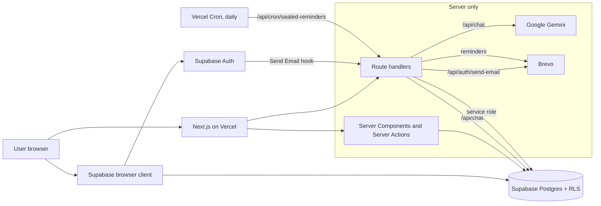
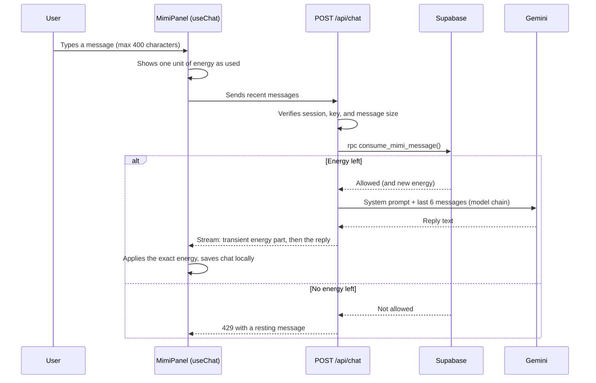

# Windup - Architecture

Status: aligned with the implemented codebase (October 2026).

## 1. Overview

Windup is a full-stack Next.js application. Server Components load data on the server, Client Components handle interaction, and almost all writes go through **Next.js Server Actions** that call Supabase. Only a few things are exposed as HTTP route handlers: the Mimi chat, the Supabase email hook, the sign-in callback, and a scheduled reminder job. Supabase provides authentication, Postgres, Row Level Security (RLS), database functions, and Realtime. Google Gemini (through the Vercel AI SDK) powers Mimi. Brevo delivers email. Vercel hosts the app and runs the cron job.

```text
Browser
  |-- Next.js pages (Server Components) --> Supabase (user session, RLS)
  |-- Client Components
  |     |-- Server Actions ---------------> Supabase (tables, views, RPC)
  |     |-- Supabase browser client ------> Auth state, Realtime, profile update
  |     `-- POST /api/chat ---------------> Supabase RPC + Gemini
  |
Supabase Auth --> POST /api/auth/send-email --> Brevo (auth emails)
Vercel Cron  --> GET  /api/cron/sealed-reminders --> Supabase (service role) + Brevo
```

The browser never receives `GEMINI_API_KEY`, `SUPABASE_SERVICE_ROLE_KEY`, `BREVO_API_KEY`, `CRON_SECRET`, or `SEND_EMAIL_HOOK_SECRET`.

### System diagram



## 2. Chosen stack

| Need | Tool | Version in `package.json` | Notes |
| --- | --- | --- | --- |
| Web framework | Next.js (App Router) | 16.3.7 | Uses `proxy.ts` (the Next.js 16 name for middleware) |
| UI library | React | 19.2.8 | `useSyncExternalStore` is used heavily for client stores |
| Language | TypeScript | ^5 | `strict` enabled, `@/*` path alias |
| Styling | Tailwind CSS | ^4 | Configured in `app/globals.css`; dark mode via a `.dark` class |
| Theming | next-themes | ^0.4.6 | Light by default, system preference ignored |
| Icons | lucide-react | ^1.48.0 | Mood and UI icons |
| Auth and database | Supabase | `@supabase/ssr` ^0.12.7, `@supabase/supabase-js` ^2.117.2 | Postgres, RLS, RPC, Realtime |
| AI orchestration | Vercel AI SDK | `ai` ^7.0.141, `@ai-sdk/react` ^4.0.145 | `useChat` on the client, `generateText` on the server |
| AI provider | Google Gemini | `@ai-sdk/google` ^4.0.96 | Model chain configurable by environment variable |
| Email | Brevo | REST API called with `fetch` | `@getbrevo/brevo` is installed but not imported |
| Hosting and cron | Vercel | n/a | `vercel.json` defines the daily reminder cron |
| Linting | ESLint 9 with `eslint-config-next` | ^9 | core-web-vitals and TypeScript rules |

Fonts: Geist, Geist Mono, and Inter (Inter is used as the "letter" font for writing and reading letters).

## 3. Project structure

```text
windup/
  app/
    layout.tsx                 Root HTML, fonts, metadata, Providers
    page.tsx                   Landing page (revalidated every 60 seconds)
    LandingPage.tsx            Welcome card, stop-motion background, plane counter
    providers.tsx              ThemeProvider and a retired, always-empty letter context
    globals.css                Tailwind, theme variables, animations
    (auth)/
      login/                   LoginPage.tsx + page.tsx
      signup/                  SignupPage.tsx + page.tsx
    (dashboard)/
      layout.tsx               ToastProvider, AuthSync, Navbar
      loading.tsx              Shared loading indicator
      fold/                    FoldPage.tsx + page.tsx
      jar/                     JarPage.tsx + page.tsx
      sky/                     SkyPage.tsx + page.tsx
      sent-planes/             SentPlanesPage.tsx + page.tsx
      settings/                SettingsPage.tsx + page.tsx
    actions/
      thoughts.ts              Server actions for letters, planes, likes, read marks
      quota.ts                 Server action to read daily quotas
    api/
      chat/route.ts            Mimi chat (Gemini)
      auth/send-email/route.ts Supabase Send Email hook (Brevo)
      cron/sealed-reminders/route.ts  Daily sealed-letter reminder job
    auth/callback/route.ts     Email confirmation landing point
  components/                  Shared UI (see section 5)
  lib/
    ai/prompts.ts              Mimi system prompt (server only)
    auth.ts                    getAuthUserId() (server)
    auth-client.ts             Profile mirror and cache purge helpers (client)
    auth-hook.ts               Webhook signature verification and payload parsing
    daily-release.ts           Release allowance helpers (client)
    email.ts                   Brevo sender (server)
    email-templates.ts         Branded email templates
    format.ts                  Date formatting
    mood.ts                    Mood definitions and styles
    public-planes.ts           Public plane counter (anonymous client)
    quota.ts                   Quota types, defaults, response parsers (shared)
    quota-client.ts            Client-side quota store (useSyncExternalStore)
    sky-planes.ts              Sample planes and plane-count helpers
    thoughts.ts                Thought types and UI/database status mapping
    validation.ts              Form validators
    hooks/                     useLocalStorage, useNow, useUserEmail
  utils/supabase/
    client.ts                  Browser Supabase client
    server.ts                  Server Supabase client (cookie based, cached per request)
    middleware.ts              Session refresh used by proxy.ts
    public.ts                  Anonymous client that never reads cookies
  types/letter.ts              Letter, Mood, status and visibility types
  supabase/                    SQL: schema, likes, quotas, email notifications, diagnostics
  public/                      Backgrounds, logo and icons, Mimi artwork
  proxy.ts                     Refreshes the Supabase session on every matched request
  vercel.json                  Cron schedule
  docs/                        This documentation
```

Notes on empty files: `lib/ai/groq.ts`, `lib/utils.ts`, `lib/supabase/client.ts`, `lib/supabase/server.ts`, `types/database.ts`, and `supabase/policies.sql` exist as zero-byte placeholders. The real Supabase clients live in `utils/supabase/`, and the RLS policy lives in `supabase/schema.sql`.

## 4. Routing, rendering, and access

Route groups organize files without changing URLs: `(auth)` for `/login` and `/signup`, `(dashboard)` for the signed-in shell.

The dashboard layout does **not** redirect. Each page decides access for itself:

| Page | Server-side behavior |
| --- | --- |
| `/fold` | Loads the user's thoughts (to edit a draft) when signed in; renders for guests in read-only mode |
| `/jar` | Redirects guests to `/login`; loads the owner's private thoughts |
| `/sky` | Loads public planes, the signed-in id, and read marks in parallel; guests can read |
| `/sent-planes` | Redirects guests to `/login`; loads public planes plus the release quota |
| `/settings` | Redirects guests to `/login` |

The landing page is static and refreshed at most once per minute (`revalidate = 60`). Server actions call `revalidatePath` for `/`, `/jar`, `/sky`, and `/sent-planes` after changes so counts update immediately.

## 5. Responsibilities by layer

| Layer | Responsibility |
| --- | --- |
| Pages (`page.tsx`) | Server Components that load data and pass it to a client page component |
| Client page components | Interaction, optimistic updates, animation, local UI state |
| Shared components | `Navbar`, `MailButton`, `LetterCard`, `ViewLetterModal`, `AlertModal`, `Toast`, `MoodPicker`, `SealDatePicker`, `SealedOpenConfirm`, `SignInPrompt`, `MimiPanel`, `FieldError`, `AuthSync` |
| Server actions | Authenticate, validate, write to Supabase, map database errors to friendly messages |
| Route handlers | Chat, auth email hook, sign-in callback, scheduled reminders |
| `lib/` | Pure helpers, quota logic, email, AI prompt, client stores |
| Supabase | Sessions, tables, view, triggers, RPC functions, RLS, Realtime |
| Gemini | Generates Mimi's reply after an authorized, quota-checked request |
| Brevo | Delivers authentication emails and sealed-letter reminders |

Unused code kept in the repository: `components/PrivacySelector.tsx`, `components/PaperPlaneCard.tsx`, and `lib/hooks/useUserEmail.ts` are not imported anywhere. The `useLetters()` context in `app/providers.tsx` is a retired stub that always returns an empty list and ignores writes; letters now live only in Supabase.

## 6. Authentication and session handling

1. A user signs up or signs in with Supabase Auth from the browser client (`signUp`, `signInWithPassword`).
2. `proxy.ts` runs before every request except static assets and images. It calls `updateSession`, which creates a server client and calls `auth.getClaims()` so an expiring session is refreshed and new cookies reach both Server Components and the browser. Responses that set auth cookies also receive the cache headers Supabase provides, so a CDN cannot serve one person's session to another.
3. On the server, `getAuthUserId()` (in `lib/auth.ts`) returns the user id from `getClaims()`. This verifies the token locally with no network call when the project uses asymmetric JWT keys. It is wrapped in React `cache()`, so a page and the actions it calls share one check per request.
4. Every query additionally filters by `user_id`, and RLS enforces `user_id = auth.uid()` again in the database.
5. The sign-up confirmation link goes to `/auth/callback`, which exchanges a `code` (PKCE) or verifies a `token_hash` for a session cookie, then redirects to `/jar` (or a validated same-site `next` path).
6. There is no `profiles` table. The display name lives in the user metadata (`display_name`), is edited through `auth.updateUser`, and is mirrored to `localStorage` for fast rendering.

Three Supabase clients exist:

| Client | File | Used for |
| --- | --- | --- |
| Browser | `utils/supabase/client.ts` | Auth state changes, `updateUser`, Realtime, Settings export |
| Server (per request, cached) | `utils/supabase/server.ts` | Server actions, pages, `/api/chat`, callback |
| Public (no cookies) | `utils/supabase/public.ts` | Counting public planes for the cacheable landing page |

The service role key is used by one file only: the scheduled reminder route, which creates its own admin client.

## 7. Client-side state and caches

| Mechanism | Purpose |
| --- | --- |
| `quota-client.ts` | A small external store (read with `useSyncExternalStore`) mirroring the daily quotas from the database. Never persisted. Answers for another account, or older than a number already shown, are discarded. Refreshes when the tab regains focus. |
| `AuthSync` | Remembers which account the browser last showed. When the account changes or ends, it wipes account-scoped browser data and refreshes server data. |
| `localStorage` keys | `windup_user_email`, `windup_display_name`, `windup_member_since` (profile mirror); `sky_read_planes` and `sky_liked_planes:<user id>` (local and sample planes, guest reads); `windup_mimi_chat:<user id>` (Mimi conversation, last 40 messages); `windup_active_user`; `theme` (next-themes). Legacy keys from the old local letter store are purged. |
| `Toast` provider | Lives in the dashboard layout so a toast raised just before a redirect stays visible on the next page. |
| Optimistic updates | Jar, Sent Planes, and likes update instantly and roll back if the server refuses. |

Account-scoped keys are listed in `lib/auth-client.ts` and are erased on sign-out or account switch. The theme is deliberately kept.

## 8. Main flows

### Save, seal, or keep a letter

```text
Fold page -> client validation -> createThought (server action)
  -> authenticate -> validate -> insert or update `thoughts`
  -> revalidate pages -> toast -> redirect to /jar (or /sky)
```

### Release a plane

```text
Fold (Release Plane) or Jar (Release) -> client checks remaining allowance
  -> createThought / changeThoughtStatus(status = released)
  -> `thoughts` BEFORE INSERT/UPDATE trigger consumes one daily release atomically
  -> trigger raises DAILY_RELEASE_LIMIT when none are left -> friendly message
  -> on success the action reads the new count back (get_user_quota) and returns it
```

### Read The Sky

```text
/sky (Server Component)
  -> public_thoughts view (100 newest, no user_id)
  + own released ids (RLS-scoped query) + liked ids (RPC) + read ids (RPC), in parallel
  -> SkyPage shuffles and shows 7 at a time; "Catch More Planes" reshuffles locally
```

### Like a plane

```text
Like -> toggleThoughtLike -> RPC toggle_thought_like (auth.uid())
  -> thought_likes row added or removed -> trigger syncs thoughts.likes
  -> returns { liked, likes } -> UI shows the real total
  -> Supabase Realtime tells the owner's Sent Planes page about the change
```

### Ask Mimi



### Sealed-letter reminder

```text
Vercel Cron (01:00 UTC daily) -> GET /api/cron/sealed-reminders (Bearer CRON_SECRET)
  -> rpc sealed_letters_due(50) -> for each letter: claim row in sealed_letter_notifications
  -> look up the owner's email (admin API) -> send Brevo email (title + link only)
  -> on a failed send, delete the claim so the next run retries
```

## 9. Data and security boundaries

### Browser-safe values

- `NEXT_PUBLIC_SUPABASE_URL`
- `NEXT_PUBLIC_SUPABASE_ANON_KEY`
- `NEXT_PUBLIC_SITE_URL` (used to build links in emails; also read on the server)
- Public plane fields, already filtered by the `public_thoughts` view

### Server-only values

| Variable | Used by |
| --- | --- |
| `GEMINI_API_KEY` | `/api/chat` |
| `GEMINI_MODELS` (optional) | `/api/chat` model chain override, comma separated |
| `SUPABASE_SERVICE_ROLE_KEY` | Scheduled reminder route only |
| `CRON_SECRET` | Scheduled reminder route |
| `SEND_EMAIL_HOOK_SECRET` | Supabase Send Email hook route |
| `BREVO_API_KEY`, `BREVO_SENDER_EMAIL`, `BREVO_SENDER_NAME` (optional) | `lib/email.ts` |
| `VERCEL_PROJECT_PRODUCTION_URL`, `VERCEL_URL` | Fallbacks for the site URL |

The service role bypasses RLS, so it is used only inside the cron route, which refuses calls that lack the cron secret. Never import server-only files into client components.

### Where each rule is enforced

| Rule | Enforced by |
| --- | --- |
| Only the owner reads or edits a letter | Query filter on `user_id` and RLS policy |
| Authors of planes stay anonymous | `public_thoughts` view omits `user_id` |
| 3 releases per day | Database trigger `thoughts_release_quota` |
| 10 Mimi messages per day | `consume_mimi_message()` called before Gemini |
| Nobody can see who liked a plane | `thought_likes` has RLS on with no policies |
| Reminder emails are sent once | Primary key on `sealed_letter_notifications` |
| Sealed letters stay hidden until the date | Interface only (see section 12) |

## 10. Performance and free-tier protection

- The landing page is cached for 60 seconds, with an anonymous count-only query (`head` request, no rows).
- The Sky loads at most 100 planes and selects only the needed columns.
- The Jar and Sent Planes fetch only the signed-in account's rows. Mail loads a lean list of sealed letters (no text).
- Quota reads use one database call for both counters, with request de-duplication in the client store.
- Mimi sends only the last 6 messages, with a 1,024 token output cap, and never runs while users scroll, save, or read.
- Daily quotas live in the database, so they cannot be reset by clearing the browser.
- Each quota update also deletes that account's `daily_usage` rows older than 7 days, so the table stays tiny.

## 11. Error handling

Server actions return result objects instead of throwing: `{ success: true }` or `{ success: false, error, code? }`.

| Situation | Behavior |
| --- | --- |
| No session | `error: "Please sign in to continue."`, `code: UNAUTHENTICATED`. If a login cookie exists but is invalid, the message says the session expired. |
| Daily release limit | `code: DAILY_LIMIT` with a friendly message. Recognized by error code and wording so a reworded trigger never leaks SQL. |
| Check or enum violation (`23514`, `22P02`) | Hints to run `supabase/schema.sql` |
| Permission denied (`42501`) | Hints at the RLS policies |
| Missing function (`PGRST202`, `42883`) | Hints to run `likes.sql` and `quotas.sql` |
| Plane no longer public (`P0002`) | "This plane is no longer in the sky." |
| Missing column (`42703`, `PGRST204`) | Hints to run `schema.sql` |
| Update affected zero rows | Treated as a failure (wrong owner or missing policy) |

Technical detail (code and message) is appended to messages only in development, never for raised application rules, and always logged on the server. In production, users see only friendly sentences.

The chat route returns JSON errors with HTTP statuses (see `4_API_ROUTES.md`). Mimi failures never block saving a letter.

## 12. Known technical limitations

- **Sealed letters are not protected server-side.** `getUserJarThoughts` selects every column, including `content`, for sealed rows, and `changeThoughtStatus` does not compare `seal_until` with the current time. The locked card and the blocked click are interface behavior.
- **Database objects missing from the repository:** the app calls `get_user_quota()`, `read_thought_ids()`, and `mark_thought_read()` and relies on a `user_thought_reads` table, none of which are defined in `supabase/*.sql`. `getUserQuota()` falls back to `get_daily_quota()`, and read-mark failures degrade to "unread", so the app still works, but a fresh database will not have these features until the SQL is added. See `3_DATABASE_SCHEMA.md`.
- **No automated tests** are present.
- **`README.md` is out of date** (it mentions Groq and omits Gemini, Brevo, and several environment variables).
- **The Sky has no server pagination**; it loads 100 planes and reshuffles locally.
- **Package name** is still `temp-windup`.

## 13. Deployment

```text
GitHub repository -> Vercel project -> environment variables -> deployment URL
                              |-> Supabase project (run the SQL files, configure Auth)
                              |-> Gemini API key
                              `-> Brevo account (verified sender)
```

Setup checklist:

1. Create a Supabase project and run, in order: `supabase/schema.sql`, `supabase/likes.sql`, `supabase/quotas.sql`, `supabase/email_notifications.sql`.
2. Add the Vercel URL (and local URL) to Supabase Auth redirect URLs.
3. In Supabase, enable the Send Email hook pointing to `https://<site>/api/auth/send-email` and copy its secret into `SEND_EMAIL_HOOK_SECRET`.
4. Add all environment variables in Vercel. `vercel.json` registers the cron job `0 1 * * *` for `/api/cron/sealed-reminders`; set `CRON_SECRET` so Vercel Cron sends it as a bearer token.
5. Verify a sender address or domain in Brevo and set `BREVO_SENDER_EMAIL`.

Supabase Realtime must include the `thoughts` table in the `supabase_realtime` publication (`likes.sql` does this when the publication exists).

## 14. Later architecture additions

- Move sealed-letter protection into the database (return content only when the unlock date has passed, and validate unsealing server-side).
- Commit the missing read-mark and combined-quota SQL to the repository.
- A moderation queue and report table.
- Server-side pagination for The Sky.
- Automated tests for server actions and SQL functions.
- A user timezone setting for the daily day boundary (the quota timezone is currently one SQL function).