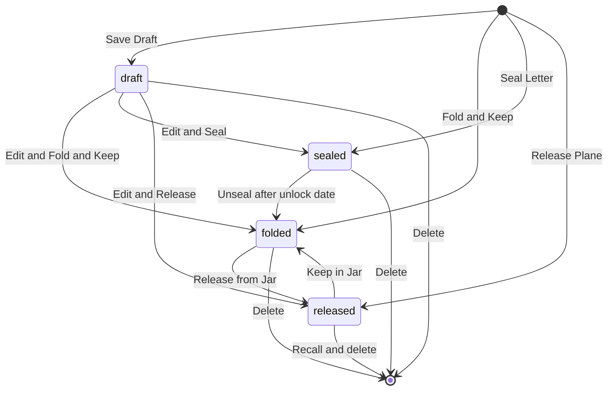
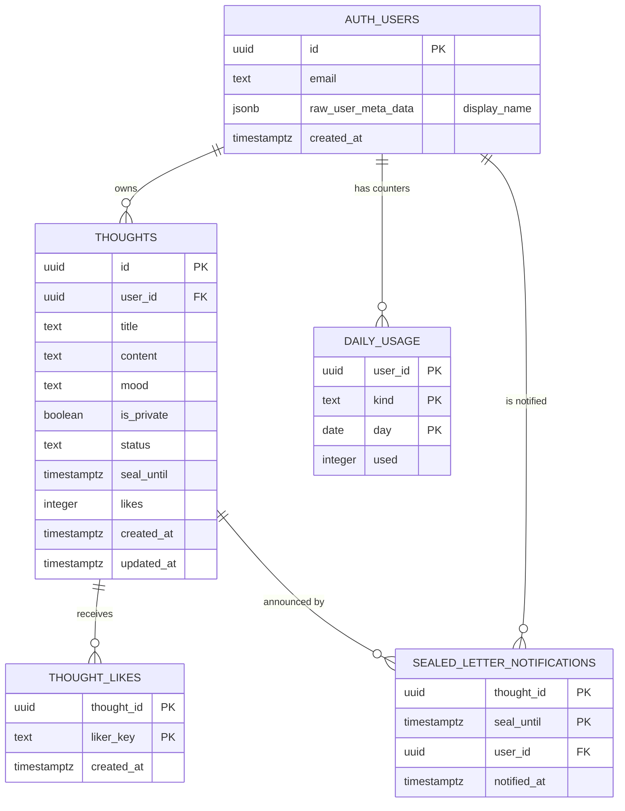

# Windup - Database Schema and Security Rules

Status: aligned with the SQL files in `supabase/` and with the queries in the application code (October 2026).

## 1. Principles

- Every letter belongs to exactly one authenticated user (`thoughts.user_id`).
- A public plane is anonymous to readers but still owned internally.
- The client is never trusted to enforce ownership or daily limits. Limits live in the database.
- Row Level Security (RLS) protects normal user access. Tables that browsers must never touch have RLS enabled with **no policies**, and are changed only through `security definer` functions.
- The application reads public data through a view, never through an open `SELECT` policy on the base table, so `user_id` cannot leak.

## 2. File inventory and run order

| File | Purpose | Notes |
| --- | --- | --- |
| `supabase/schema.sql` | `thoughts` table, constraints, indexes, `updated_at` trigger, RLS policy, `public_thoughts` view | Run first. Safe to re-run and repairs an older hand-made table (converts an enum status to text, drops old CHECK constraints, normalizes rows). Runs in one transaction. |
| `supabase/likes.sql` | `thought_likes` table, like functions, like-count trigger, Realtime publication | Run after `schema.sql`. Safe to re-run. |
| `supabase/quotas.sql` | `daily_usage` table, quota functions, release-limit trigger, Mimi consume function | Run after `schema.sql` and `likes.sql`. Safe to re-run. |
| `supabase/email_notifications.sql` | `sealed_letter_notifications` table and `sealed_letters_due()` | Run after `schema.sql`. Does not touch `thoughts`. |
| `supabase/diagnose_thoughts.sql` | Read-only diagnostics (columns, constraints, enum values, RLS, triggers, status counts, view definition) | Changes nothing. Run when releasing or opening letters fails (error codes `23514`, `22P02`). |
| `supabase/policies.sql` | Empty file | The one policy lives in `schema.sql`. |

If the app reports a missing function right after running a file, refresh the API schema cache with `notify pgrst, 'reload schema';`.

### Objects the application uses that are not in these files

The code calls the following, but no SQL file in the repository defines them:

| Object | Used by | Behavior when absent |
| --- | --- | --- |
| `get_user_quota()` (RPC) | `app/actions/quota.ts`, which reads both counters in one call | Falls back to `get_daily_quota(p_kind)` for each counter, which is defined in `quotas.sql` |
| `read_thought_ids()` (RPC) | `getReadThoughtIds()` for The Sky | Logs an error and returns an empty list (planes appear unread) |
| `mark_thought_read(p_thought_id)` (RPC) | `markThoughtRead()` when a plane is opened | The action reports a failure that the interface ignores; the plane shows as unread again |
| `user_thought_reads` (table, named in code comments) | Backing store for the two read-mark functions | n/a |

From the way the code uses them: `get_user_quota()` returns a single row shaped like `{ mimi_energy, planes_released_today, plane_limit }` (energy left today, planes released today, and the daily plane limit); `read_thought_ids()` returns a set of plane ids for `auth.uid()`; `mark_thought_read` records that `auth.uid()` opened a plane and ignores repeats. These definitions should be added to the repository (see `ROADMAP.md`).

## 3. Status model

The database stores five status values in a plain `text` column:

```text
draft | folded | sealed | opened | released
```

The interface uses a slightly different vocabulary:

| Interface status | Database status | Notes |
| --- | --- | --- |
| `draft` | `draft` | Unfinished private letter |
| `kept` | `folded` | Private letter on the Kept shelf. "Folded" is the database name for "kept". |
| `sealed` | `sealed` | Private letter locked until `seal_until` |
| `opened` | `opened` | Legacy. The interface now shows an opened letter as `kept`, and unsealing writes `folded`. |
| `released` | `released` | Public anonymous plane |
| `unpublished` | `folded` | A plane moved back to the Jar is simply a kept letter. There is no stored "unpublished" state. |

Mapping code lives in `lib/thoughts.ts` (`toThoughtStatus`, `toLetterStatus`, `thoughtToLetter`).

Visibility is a boolean, not an enum:

| `is_private` | Meaning |
| --- | --- |
| `true` | Private to the owner (draft, folded, sealed, opened) |
| `false` | Public (only when `status = 'released'`) |

The interface derives its `visibility` field (`private` or `anonymous_public`) from `is_private`. A `sealed` visibility value exists in the TypeScript type but is never stored.

## 4. Tables

### `thoughts`

The single table for drafts, kept letters, sealed letters, and public planes.

| Column | Type | Notes |
| --- | --- | --- |
| `id` | `uuid` | Primary key, default `gen_random_uuid()` |
| `user_id` | `uuid` | Not null, references `auth.users(id)` with `on delete cascade` |
| `title` | `text` | Optional, at most 120 characters |
| `content` | `text` | Not null, 1 to 10,000 characters |
| `mood` | `text` | One of `neutral`, `peaceful`, `reflective`, `nostalgic`, `heavy`, `hopeful` (normalized by the application; not constrained in SQL) |
| `is_private` | `boolean` | Not null, default `true` |
| `status` | `text` | Not null, default `'folded'` |
| `seal_until` | `timestamptz` | Set only while sealed; cleared by the application for other statuses |
| `likes` | `integer` | Not null, default 0; kept equal to the real like count by a trigger |
| `created_at` | `timestamptz` | Default `now()` |
| `updated_at` | `timestamptz` | Default `now()`; refreshed by a trigger on every update |

Constraints:

```sql
constraint thoughts_status_check
  check (status in ('draft', 'folded', 'sealed', 'opened', 'released'));

constraint thoughts_limits_check
  check (
    (title is null or char_length(title) <= 120)
    and char_length(content) between 1 and 10000
    and ((status = 'released') = (is_private = false))
  );
```

The last line is the visibility rule: a row is public if and only if its status is `released`.

Indexes:

```sql
create index thoughts_owner_idx  on public.thoughts (user_id, created_at desc);
create index thoughts_public_idx on public.thoughts (created_at desc) where status = 'released';
```

Triggers on `thoughts`:

| Trigger | When | Effect |
| --- | --- | --- |
| `thoughts_set_updated_at` | Before every update | Sets `updated_at = now()` |
| `thoughts_release_quota` | Before insert, or update of `status` | Consumes one daily release whenever a row becomes `released`; raises `DAILY_RELEASE_LIMIT` (error code `P0001`) when none are left (defined in `quotas.sql`) |

Because the quota trigger fires only on inserts and on updates of `status`, a like (which updates only `likes`) never consumes a release.

### `thought_likes`

One row per like. Closed to browsers (RLS on, no policies, all privileges revoked from `anon` and `authenticated`).

| Column | Type | Notes |
| --- | --- | --- |
| `thought_id` | `uuid` | References `thoughts(id)` with `on delete cascade` |
| `liker_key` | `text` | `u:<user id>` for a signed-in user, or `g:<guest uuid>` for a guest id |
| `created_at` | `timestamptz` | Default `now()` |

Primary key: `(thought_id, liker_key)`. This guarantees one like per account per plane.

The database also supports guest likers through `g:` keys, but the application currently makes guests read-only and only ever sends signed-in likes.

A trigger (`thought_likes_sync`) increments or decrements `thoughts.likes` after each insert or delete, so the public view and the owner's Sent Planes always show the same number.

### `daily_usage`

Per-account daily counters for the two quotas. RLS on, no policies, all privileges revoked from `anon` and `authenticated`.

| Column | Type | Notes |
| --- | --- | --- |
| `user_id` | `uuid` | References `auth.users(id)` with `on delete cascade` |
| `kind` | `text` | `release` or `mimi` |
| `day` | `date` | The quota day, in the timezone returned by `quota_timezone()` |
| `used` | `integer` | Not null, default 0, at least 0 |

Primary key: `(user_id, kind, day)`.

### `sealed_letter_notifications`

Remembers which sealed letters were already announced by email, so nobody is emailed twice. RLS on, no policies: only the service role key can read or write it.

| Column | Type | Notes |
| --- | --- | --- |
| `thought_id` | `uuid` | References `thoughts(id)` with `on delete cascade` |
| `user_id` | `uuid` | References `auth.users(id)` with `on delete cascade` |
| `seal_until` | `timestamptz` | The unlock date that was announced |
| `notified_at` | `timestamptz` | Default `now()` |

Primary key: `(thought_id, seal_until)`. If a letter is re-sealed for a new date, it can be announced again for that date.

### `auth.users` (Supabase-managed)

There is no application `profiles` table. The display name is stored in `auth.users.raw_user_meta_data` as `display_name`, set at sign-up and updated from Settings with `auth.updateUser`. The member-since year comes from `created_at`.

## 5. Public view

```sql
create view public.public_thoughts as
  select id, title, content, mood, likes, created_at
  from public.thoughts
  where status = 'released' and is_private = false;

revoke all on public.public_thoughts from public;
grant select on public.public_thoughts to anon, authenticated;
```

Views run with their owner's rights, so the view can read released rows that the caller does not own, while exposing no author information. This is what The Sky and the landing-page counter read. Guests (the `anon` role) can read it.

Which planes are "mine" is answered separately by a query on `thoughts` filtered by `user_id` and `status = 'released'`, which RLS limits to the caller's rows.

## 6. Row Level Security

```sql
alter table public.thoughts enable row level security;

create policy "users manage own thoughts"
  on public.thoughts for all to authenticated
  using (user_id = auth.uid())
  with check (user_id = auth.uid());
```

- There is deliberately no public `SELECT` policy on `thoughts`.
- `thought_likes`, `daily_usage`, and `sealed_letter_notifications` have RLS enabled and no policies, so they are unreachable from browsers. Only the functions below (which are `security definer`) and the service role touch them.
- Because the owner policy covers `select`, an owner can read the full row, including the text of their own sealed letters. See the limitation in section 11.

## 7. Functions

All `security definer` functions use `set search_path = public`.

### Quota functions (`quotas.sql`)

| Function | Returns | Access | Purpose |
| --- | --- | --- | --- |
| `quota_timezone()` | `text` | internal | Timezone for the day boundary. Currently `'UTC'`. Change this one function (for example to `'Asia/Manila'`) to reset at local midnight. |
| `quota_day()` | `date` | internal | Current date in that timezone |
| `quota_limit(p_kind)` | `integer` | internal | `release` = 3, `mimi` = 10 |
| `consume_daily_quota(p_user_id, p_kind)` | `boolean` | internal only (revoked from all roles) | Atomically uses one unit. Inserts the day's row if needed, then increments `used` only while `used < limit`. Concurrent requests queue on the row lock, so the limit can never be overshot. Also deletes that account's rows older than 7 days. Returns false when the limit is already reached. |
| `enforce_release_quota()` | trigger | internal only | Trigger function that calls `consume_daily_quota(new.user_id, 'release')` when a row becomes released |
| `get_daily_quota(p_kind)` | `table(used, daily_limit)` | `authenticated` | Usage and limit for the caller (`auth.uid()`) |
| `consume_mimi_message()` | `boolean` | `authenticated` | Requires a session and calls `consume_daily_quota(auth.uid(), 'mimi')`. Called by `/api/chat` before contacting Gemini. |

The application tolerates newer versions of `consume_mimi_message()` that also return the energy left (a number, or a row with an allowed flag and counts). `lib/quota.ts` contains the parsers, and keeps `DEFAULT_DAILY_LIMITS` (release 3, Mimi 10) as a display fallback that must stay in step with `quota_limit()`.

### Like functions (`likes.sql`)

| Function | Returns | Access | Purpose |
| --- | --- | --- | --- |
| `viewer_like_key(p_guest_id)` | `text` | internal | `u:<uid>` when signed in, `g:<uuid>` for a valid guest id, otherwise null |
| `toggle_thought_like(p_thought_id, p_guest_id)` | `table(liked, likes)` | `anon`, `authenticated` | Raises if no identity or the plane is not released and public (`P0002`). Deletes the caller's like if present, otherwise inserts it. Returns the new state and the real total. |
| `liked_thought_ids(p_guest_id)` | `setof uuid` | `anon`, `authenticated` | Ids of planes the caller has liked, so hearts stay filled after a reload |
| `sync_thought_likes()` | trigger | internal only | Keeps `thoughts.likes` equal to the number of `thought_likes` rows |

### Reminder function (`email_notifications.sql`)

| Function | Returns | Access | Purpose |
| --- | --- | --- | --- |
| `sealed_letters_due(p_limit)` | `table(thought_id, user_id, title, seal_until)` | `service_role` only | Sealed letters whose `seal_until` has passed and that have no notification for that exact unlock date, oldest first. The limit is clamped between 1 and 200 (default 50). It spans every account, so only the server may call it. |

### Utility

| Function | Purpose |
| --- | --- |
| `set_updated_at()` | Trigger function that refreshes `updated_at` |

## 8. Realtime

`likes.sql` adds `public.thoughts` to the `supabase_realtime` publication when that publication exists. The Sent Planes page subscribes to `UPDATE` events on `thoughts` filtered by `user_id=eq.<user id>`. RLS still applies, so only the owner receives changes. This is how an owner sees new likes without reloading.

## 9. Letter life cycle

```text
(new) -> draft
(new) -> folded (kept)
(new) -> sealed
(new) -> released

draft  -> folded | sealed | released
folded -> sealed* | released
sealed -> folded (unsealed after the unlock date)
released -> folded (Keep in Jar) | deleted
any    -> deleted
```

`*` The interface offers sealing only when writing a new letter, not from an existing kept letter.



Every transition into `released` consumes one daily release (trigger). Transitions out of `released`, and deletes, do not refund it.

## 10. Entity relationship diagram



The view `public_thoughts` (a safe projection of `thoughts`) is not drawn. The read-mark storage that the code expects but that is not defined in the repository's SQL (section 2) is also omitted.

## 11. Security limitations

- **Sealed letter text is readable by its owner at the API level.** The owner policy allows `select *`, and the application's Jar query returns `content` for sealed rows. Nothing in the database prevents an owner from reading or unsealing a letter before `seal_until`. To make sealing real, expose sealed rows through a view or function that nulls `content` until `seal_until <= now()`, and validate unsealing in a function.
- **Authors can learn their own plane's like total live** but not who liked it, because `thought_likes` is unreadable.
- **Hearts rely on `auth.uid()`.** The server action passes no account id; the database derives it from the session.
- **Mood is not constrained in SQL.** The server normalizes unknown values to `neutral`, but a direct database write could store any string.
- **No report or moderation table exists.**

## 12. Differences from the earlier design

The first design used `profiles`, `letters`, `ai_requests`, `ai_reflections`, and `reports` tables, `letter_status` and `letter_visibility` enums, a `get_sky_letters` cursor function, and a `release_letter` RPC. None of these exist. The implemented model is the single `thoughts` table with a text status and boolean privacy flag, plus likes, quotas, and reminder bookkeeping tables, and the database trigger replaces the proposed release RPC.