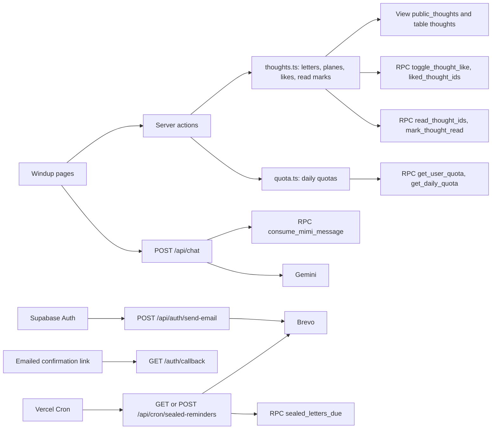

# Windup - API Routes, Server Actions, and Database Calls

Status: aligned with the implemented codebase (October 2026).

## 1. Purpose

Windup exposes server behavior in three layers:

1. **Route handlers** (HTTP endpoints under `app/`): the Mimi chat, the Supabase Send Email hook, the sign-in callback, and a scheduled reminder job.
2. **Server actions** (`app/actions/*.ts`, marked `'use server'`): every letter, plane, like, read-mark, and quota operation. These are called directly from components and Server Components, not over a hand-written REST API.
3. **Database RPC functions** (Postgres, called through Supabase): quota consumption, likes, read marks, and reminder lookup.

Anything the browser must not control by itself (public-release limits, Mimi limits, AI provider calls, cross-account lookups) goes through one of these layers. Every layer authenticates from the server-side Supabase session and avoids returning internal fields such as `user_id` in public responses.

## 2. Shared conventions

### Authentication

- Server actions and `/api/chat` call `getAuthUserId()`, which verifies the session token. Without a user, server actions return `{ success: false, error: "Please sign in to continue.", code: "UNAUTHENTICATED" }`, and `/api/chat` returns HTTP `401` with `{ "error": "Please sign in to continue." }`.
- Database functions read the account from `auth.uid()`. The account id is never accepted from the client.
- The scheduled job and the email hook use shared secrets instead of a user session (sections 5 and 12).

### Validation

No schema validation library (such as Zod) is used. Validation is hand-written and repeated in the editor, the action or route, and the database.

| Field | Editor | Server action or route | Database |
| --- | --- | --- | --- |
| Letter title | Optional, 100 characters | Optional, 120 characters | Optional, 120 characters |
| Letter body | Required, 1,000 words | Required (trimmed), 10,000 characters | 1 to 10,000 characters |
| Mood | One of six moods | Normalized with `toMood()`; unknown values become `neutral` | Not constrained |
| Status and privacy | n/a | `released` must be public and everything else private | `(status = 'released') = (is_private = false)` |
| Seal date | Future date and time | Passed through for `sealed` letters, otherwise cleared | Not constrained |
| Mimi message | 400 characters | Last user message required and at most 6,000 characters; only the last 6 messages are used | n/a |
| Plane id (like, read mark) | n/a | Must match a UUID pattern | n/a |
| Display name | Single word, no spaces | n/a (stored in Supabase user metadata) | n/a |

### Action result shapes

```ts
// Mutations (changeThoughtStatus, deleteThought, markThoughtRead)
type ThoughtActionResult =
  | { success: true; quota?: DailyQuota | null }   // quota is set after a release
  | { success: false; error: string; code?: 'UNAUTHENTICATED' | 'DAILY_LIMIT' };

// createThought
type CreateThoughtResult =
  | { success: true; data: ThoughtRow }
  | { success: false; error: string; code?: 'UNAUTHENTICATED' | 'DAILY_LIMIT' };

// toggleThoughtLike
type ToggleLikeResult =
  | { success: true; liked: boolean; likes: number }
  | { success: false; error: string; code?: 'UNAUTHENTICATED' | 'DAILY_LIMIT' };

// DailyQuota
interface DailyQuota { userId: string; used: number; limit: number }
```

Actions return result objects instead of throwing, so the interface can restore optimistic updates and show a friendly message. Technical detail is logged on the server and appended to messages only in development.

### HTTP status codes used by route handlers

| Status | Meaning |
| --- | --- |
| `200` | Success |
| `400` | Invalid request (chat body, hook body, missing token data) |
| `401` | No session (chat), bad cron secret, or bad hook signature |
| `429` | Mimi's daily energy is used up |
| `500` | Unexpected failure, or the email hook is not configured |
| `502` | The email hook could not send through Brevo |
| `503` | Gemini unavailable or not configured, quota function failing, or the cron job not configured |

## 3. Route map



## 4. `POST /api/chat`

File: `app/api/chat/route.ts`. Mimi's chat endpoint. Runtime limit: `maxDuration = 30` seconds.

### Request

The body is the message list produced by `useChat` from `@ai-sdk/react`:

```json
{
  "messages": [
    { "id": "abc", "role": "user", "parts": [{ "type": "text", "text": "i passed my exam" }] }
  ]
}
```

### Server work (in order)

1. Verify the session (`401` if missing).
2. Require `GEMINI_API_KEY` (`503`, "GEMINI_API_KEY is not configured on the server.").
3. Parse the body. A body that is not valid JSON, or has no messages, returns `400` ("Invalid request.").
4. Keep only the most recent 6 messages. Find the last user message. It must be non-empty and at most 6,000 characters, otherwise `400`.
5. Call `rpc consume_mimi_message()`. This uses one unit of the account's daily energy before the AI provider is contacted.
   - If the function itself fails (for example `quotas.sql` was not run): `503` with the friendly pause message.
   - If it says no energy is left: `429`.
6. Convert the messages with `convertToModelMessages` and call Gemini with the Mimi system prompt (`lib/ai/prompts.ts`), `maxOutputTokens = 1024`, and `maxRetries = 1`.
7. Models are tried in order until one answers. The default chain is `gemini-3.8-flash`, `gemini-3.6-flash`, `gemini-3.1-flash-lite`. Set `GEMINI_MODELS` (comma separated) to override it. A busy, retired, or failing model, or an empty reply, moves to the next model. If all fail, return `503`.
8. Work out the energy to display: the value `consume_mimi_message()` returned, or, if it only returned a boolean, a fresh read through `getUserQuota()`.
9. Reply as a UI message stream (`createUIMessageStreamResponse`): first a **transient** data part, then the text. "Transient" means it reaches the client's `onData` handler only and is never stored in the conversation.

### Success response (stream parts)

```text
data-mimiEnergy (transient)  { "used": 3, "limit": 10, "remaining": 7 }
text-start
text-delta                   "That is wonderful! You could start your letter by..."
text-end
```

The reply is generated in full on the server and then sent as a single text delta.

### Error responses

| Status | Body | When |
| --- | --- | --- |
| `400` | `{ "error": "Invalid request." }` | Bad body, no messages, empty or oversized last user message |
| `401` | `{ "error": "Please sign in to continue." }` | No session |
| `429` | `{ "error": "Mimi is resting for today. Her battery will be full again tomorrow, so come back then to write more together.", "code": "DAILY_LIMIT" }` | Energy used up |
| `500` | `{ "error": "Mimi is taking a short pause. Please try again in a moment." }` | Unexpected failure |
| `503` | `{ "error": "GEMINI_API_KEY is not configured on the server." }` | Missing API key |
| `503` | `{ "error": "Mimi is taking a short pause. Please try again in a moment." }` | Quota function failed, or every Gemini model failed |

In development (`NODE_ENV === 'development'`) the `500` and `503` messages also include the failing stage and provider detail. A failed Gemini call still counts as a used message; there is deliberately no way to return a unit.

## 5. `POST /api/auth/send-email`

File: `app/api/auth/send-email/route.ts`. The Supabase **Send Email** Auth Hook. Supabase calls this route instead of sending its own plain email, and Windup sends a branded version through Brevo. Because the hook replaces every auth email, the route handles all of them: sign-up confirmation, magic link, invite, password recovery, email change, and re-authentication.

Configure it in Supabase under Authentication, Hooks, Send Email, with the HTTPS URL `https://<site>/api/auth/send-email`, and copy the generated secret into `SEND_EMAIL_HOOK_SECRET`.

### Server work

1. Require `SEND_EMAIL_HOOK_SECRET` and `NEXT_PUBLIC_SUPABASE_URL` (otherwise `500`).
2. Read the raw body as text (the signature covers the exact bytes).
3. Verify the Standard Webhooks signature: HMAC-SHA256 over `<webhook-id>.<webhook-timestamp>.<body>` using the secret. Timestamps more than 5 minutes off are rejected so a captured request cannot be replayed. Several signatures in the header (during secret rotation) are accepted. Invalid: `401`.
4. Parse the payload (`user.email` and `email_data` are required). Invalid: `400`.
5. Build the action link, the same one Supabase's default template uses: `{SUPABASE_URL}/auth/v1/verify?token=<token_hash>&type=<email_action_type>&redirect_to=<redirect_to>`. After the click, the reader lands on `/auth/callback`.
6. A link-based email without a token hash, or a re-authentication email without a code, returns `400`.
7. Render the template (`lib/email-templates.ts`) with the display name from user metadata, and send through Brevo with the tag `auth-<type>`.
8. A failed send returns `502` with `{ "error": { "http_code": 502, "message": "We could not send the email. Please try again." } }`, which Supabase reports to the person who triggered it.

### Success response

```json
{}
```

Errors use the shape Supabase expects: `{ "error": { "http_code": <status>, "message": "<text>" } }`. The route is `force-dynamic`.

## 6. `GET /auth/callback`

File: `app/auth/callback/route.ts`. The landing point for the confirmation link in the sign-up email.

### Query parameters

| Parameter | Meaning |
| --- | --- |
| `code` | PKCE flow: exchanged with `exchangeCodeForSession` |
| `token_hash` and `type` | Token-hash flow: verified with `verifyOtp` |
| `next` | Optional path to continue to. Only same-site relative paths starting with a single `/` are accepted; anything else becomes `/jar` (prevents open redirects). |

### Behavior

- On success: redirect to `<origin><next>` (default `/jar`) with the session cookie set.
- On failure or missing parameters: redirect to `/login?error=confirmation_failed`, which shows "That confirmation link is invalid or has expired. Please sign in, or sign up again."

## 7. Server actions: letters, planes, likes, read marks

File: `app/actions/thoughts.ts`. Limits used internally: title 120 characters, body 10,000 characters, Sky feed 100 planes.

After any change, `revalidatePath` refreshes `/`, `/jar`, `/sky`, and `/sent-planes` (likes refresh only `/sky` and `/sent-planes`; marking a plane read refreshes nothing, so the sky does not reshuffle under the reader).

### `createThought(data)`

Saves a new letter, or updates one the user owns when `id` is given (used when editing a draft).

```ts
interface CreateThoughtInput {
  id?: string;
  title?: string;
  content: string;
  mood?: string;
  is_private: boolean;
  status: 'draft' | 'folded' | 'sealed' | 'opened' | 'released';
  seal_until?: string | null;   // ISO date; kept only for sealed letters
}
```

Server work:

1. Require a session.
2. Trim the title and content. Reject empty content ("Please write something before saving."), content over 10,000 characters, or a title over 120 characters.
3. Reject an invalid pairing: `released` must be public, and everything else must be private ("Invalid visibility for this status.").
4. Normalize the mood with `toMood()`. Keep `seal_until` only for `sealed`, otherwise store null.
5. Insert (with `user_id` from the session) or update (filtered by `id` and `user_id`), then select the row.
6. If the status is `released`, the database trigger consumes one daily release. When none are left, the result is `{ success: false, code: 'DAILY_LIMIT', error: "You have reached your daily limit of 3 paper planes for today. Please try again tomorrow!" }`.

Returns `{ success: true, data: ThoughtRow }` or a failure.

### `getPublicThoughts()`

Returns the data for The Sky: up to 100 most recent planes.

Three independent reads run in parallel:

1. `public_thoughts` view: `id, title, content, mood, likes, created_at`, newest first.
2. The signed-in user's own released ids from `thoughts` (RLS-scoped), to mark planes as theirs.
3. RPC `liked_thought_ids()`, to mark planes the reader has liked.

Result items:

```ts
interface PublicThought {
  id: string;
  title: string;        // "Untitled Thought" when empty
  content: string;
  mood: string;         // "peaceful" when empty
  likes: number;
  createdAt: string;
  isOwner: boolean;     // true when the signed-in reader wrote it
  likedByMe: boolean;   // always false for guests
}
```

It never includes `user_id`. A failing feed returns an empty list; a failing likes lookup is logged and planes simply show as not liked.

### `getUserJarThoughts()`

Returns the signed-in account's private rows (`is_private = true`), newest first, with every column (`select *`). Returns `[]` for guests. The query filters by the session user and RLS enforces it again.

### `getSealedCapsules()`

Lean list for the Mail button: `{ id, title, sealUntil }` for the account's sealed letters (no text), ordered by the earliest unlock date. The client compares each date with a live clock to find the ones that are ready.

### `changeThoughtStatus(id, status)`

Moves a letter between states. Used to open (unseal) a letter, release a letter, and return a plane to the Jar.

- Sets `status` and `is_private = (status !== 'released')`, filtered by `id` and `user_id`.
- Zero updated rows is treated as a failure (wrong owner or missing policy).
- When `status` is `released`, the database trigger counts the release. On success the action reads the account's quota back with `getUserQuota()` and returns it as `quota`, so the "Sent Planes" counter changes at once. A failed quota read never fails a release that worked.

Callers: Jar (release, unseal to `folded`), Sent Planes (Keep in Jar = `folded`), Mail (unseal = `folded`).

This action does not check `seal_until`. See the limitation in section 14.

### `deleteThought(id)`

Permanently deletes a letter or plane the user owns. Zero deleted rows is a failure. Does not refund a release.

### `toggleThoughtLike(thoughtId)`

Likes or unlikes a released plane. Signed-in users only.

1. Reject ids that are not UUIDs.
2. If there is no session, return `UNAUTHENTICATED`. When a login cookie exists but cannot be verified, the message says the session expired.
3. Call RPC `toggle_thought_like(p_thought_id)`. The database derives the account from `auth.uid()`.
4. Revalidate `/sky` and `/sent-planes`.

Returns `{ success: true, liked, likes }` with the real total. Error code `P0002` (plane not public any more) becomes "This plane is no longer in the sky."

### `getReadThoughtIds()`

Returns the ids of planes the signed-in reader has opened (RPC `read_thought_ids()`). Returns `[]` for guests, and on failure (planes show as unread). Results are filtered to valid UUIDs.

### `markThoughtRead(thoughtId)`

Records that the signed-in reader opened a plane (RPC `mark_thought_read`). Safe to repeat. Guests are rejected; the interface keeps their read marks in the browser instead.

## 8. Server actions: quotas

File: `app/actions/quota.ts`.

### `getUserQuota()`

Today's usage for the signed-in account, for both counters, from one RPC call.

```ts
Record<'release' | 'mimi', DailyQuota | null> | null   // null for guests
```

- Calls `get_user_quota()` and parses the answer with `parseUserQuota()` (lenient about row shape).
- For any counter that could not be read, falls back to `get_daily_quota(p_kind)`.
- A counter that cannot be read at all is `null`, so the interface shows a loading state instead of a made-up zero.

### `getDailyQuota(kind)`

One counter of `getUserQuota()`, for callers that need only `release` or `mimi`.

## 9. Database RPC reference

| RPC | Called from | Purpose |
| --- | --- | --- |
| `consume_mimi_message()` | `/api/chat` | Uses one Mimi message; returns whether allowed (and optionally the new energy) |
| `get_user_quota()` | `getUserQuota()` | Both counters in one call (not defined in the repository's SQL) |
| `get_daily_quota(p_kind)` | `getUserQuota()` fallback | Used and limit for one counter |
| `toggle_thought_like(p_thought_id)` | `toggleThoughtLike()` | Like or unlike |
| `liked_thought_ids()` | `getPublicThoughts()` | Planes the reader liked |
| `read_thought_ids()` | `getReadThoughtIds()` | Planes the reader opened (not defined in the repository's SQL) |
| `mark_thought_read(p_thought_id)` | `markThoughtRead()` | Save a read mark (not defined in the repository's SQL) |
| `sealed_letters_due(p_limit)` | Cron route | Sealed letters due for an email (service role only) |

Release limits are not an RPC: they are enforced by the trigger `thoughts_release_quota` during `insert` and `update` of `status`. Full details are in `3_DATABASE_SCHEMA.md`.

## 10. Browser-side Supabase calls

A few operations use the browser Supabase client directly rather than a server action:

| Where | Call | Purpose |
| --- | --- | --- |
| Login | `auth.signInWithPassword` | Sign in |
| Sign up | `auth.signUp` (with `display_name` metadata and `emailRedirectTo = /auth/callback`) | Create account |
| Navbar | `auth.signOut` | Sign out |
| Settings | `auth.updateUser({ data: { display_name } })` | Change the display name |
| Settings | `from('thoughts').select('*').eq('user_id', ...)` | Export a JSON backup (protected by RLS) |
| Sent Planes | Realtime channel on `thoughts` updates, filtered by `user_id` | Live like counts |
| Quota store, Sky, Mimi, AuthSync | `auth.onAuthStateChange` | React to sign-in, sign-out, account switch |

## 11. Page access summary

| URL | Guest | Signed in | Data loaded on the server |
| --- | --- | --- | --- |
| `/` | Yes | Yes | Public plane count (cached 60 seconds) |
| `/login`, `/signup` | Yes | Yes | None |
| `/auth/callback` | Yes | Yes | None (redirects) |
| `/fold` | Read-only | Full | The user's thoughts (to load a draft) |
| `/jar` | Redirect to `/login` | Yes | `getUserJarThoughts()` |
| `/sky` | Read only | Yes, can like | `getPublicThoughts()`, auth id, `getReadThoughtIds()` |
| `/sent-planes` | Redirect to `/login` | Yes | `getPublicThoughts()`, `getUserQuota()` |
| `/settings` | Redirect to `/login` | Yes | None |

## 12. `GET` or `POST /api/cron/sealed-reminders`

File: `app/api/cron/sealed-reminders/route.ts`. A scheduled job that emails the owner of every sealed letter whose date has arrived, once. The email is a reminder and a link to My Jar only; the letter's text is never put in an email.

Schedule (`vercel.json`): `0 1 * * *`, daily at 01:00 UTC. Vercel Cron calls `GET`; `POST` exists for running it by hand. Limits: `force-dynamic`, `maxDuration = 60`, batch size 50 letters per run (Brevo's free plan allows 300 emails a day).

### Authentication

Requires `Authorization: Bearer <CRON_SECRET>`, compared in constant time. Missing configuration (`CRON_SECRET`, `NEXT_PUBLIC_SUPABASE_URL`, `SUPABASE_SERVICE_ROLE_KEY`) returns `503`; a wrong secret returns `401`.

The job needs the service role key because it looks across all accounts. That key bypasses RLS, so it is used only here.

### Server work

1. Create an admin Supabase client.
2. Call RPC `sealed_letters_due(50)`. If it fails (for example `email_notifications.sql` was not run): `500`.
3. For each letter:
   1. **Claim it first** by inserting `(thought_id, user_id, seal_until)` into `sealed_letter_notifications`. A duplicate-key error (`23505`) means another run already claimed it, so it is skipped. This makes overlapping runs safe.
   2. Look up the owner's email with the admin auth API. With no address, the letter is skipped and the claim stays, so it is not retried forever.
   3. Send the "Your sealed Windup letter is ready to open" email through Brevo, with the optional title and a link to `/jar`.
   4. If sending fails, delete the claim so the next run retries.

### Success response

```json
{ "due": 3, "sent": 2, "skipped": 1, "failed": 0 }
```

## 13. Email delivery

File: `lib/email.ts`. Emails go through Brevo's `POST https://api.brevo.com/v3/smtp/email` with `fetch` (10 second timeout, never throws). Required: `BREVO_API_KEY` and `BREVO_SENDER_EMAIL` (a sender verified in Brevo). Optional: `BREVO_SENDER_NAME` (default "Windup"). Links in emails are built from `NEXT_PUBLIC_SITE_URL`, then `VERCEL_PROJECT_PRODUCTION_URL` or `VERCEL_URL`, then `http://localhost:3000`.

Templates (`lib/email-templates.ts`) are table-based HTML with inline styles and a plain-text version. Every dynamic value is HTML-escaped. Brevo tags identify each type: `auth-signup`, `auth-recovery`, and so on, and `sealed-letter-unlocked`.

## 14. Limitations and not implemented

- **No seal check on unsealing.** `changeThoughtStatus` does not compare `seal_until` with the current time, and the Jar query returns the text of sealed letters. The lock is interface behavior (see `3_DATABASE_SCHEMA.md`).
- **No reports route.** There is no way to report a public plane.
- **No cursor-paginated sky route.** The Sky loads 100 planes through a server action.
- **No dedicated letter routes.** The earlier plan for `POST /api/letters/release`, `/seal`, `/unpublish`, and `/open` was replaced by server actions plus a database trigger.
- **No Mimi prompt, reflect, or title routes.** Mimi is a single chat endpoint.
- **No rate limiting beyond the daily quotas.** Requests are limited only by the quota functions.
- **Likes are not callable by guests** even though the database function supports guest ids.