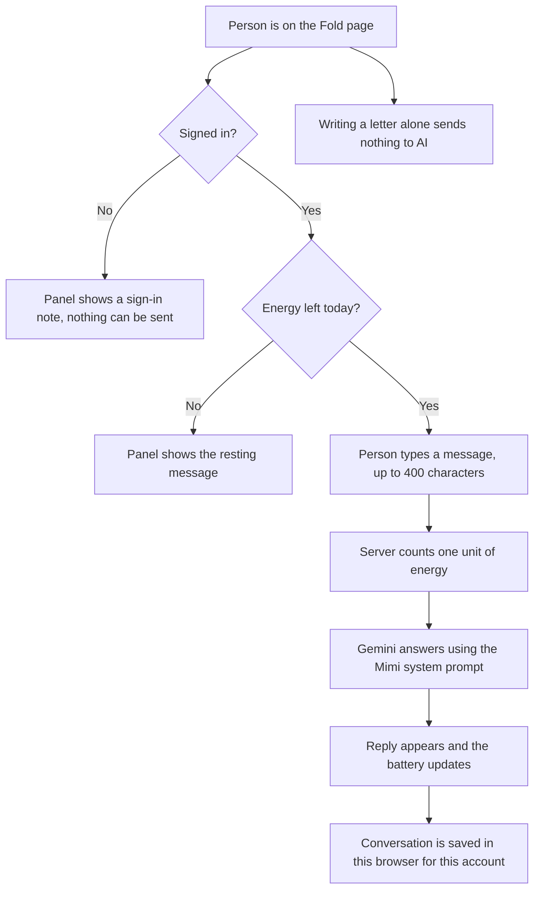

# Windup - Mimi AI Companion

Status: aligned with the implemented codebase (October 2026).

## 1. Who Mimi is

Mimi is Windup's optional AI writing companion, presented as a gentle papercraft robot. She is not a friend pretending to be human, a therapist, or an authority on anyone's life. Her purpose is narrow: she is a **letter-writing muse and brainstorming companion**. Everything she does should help a person put what they feel or think into a letter.

The interface says it plainly: **"Mimi is an AI companion. She responds only when you ask."**

Mimi lives in the **Ask Mimi** panel on the Fold page, labeled "Companion". It is a short chat, not a set of buttons.

## 2. How the implementation differs from the original plan

The first design described three discrete actions (Help me start, Reflect with Mimi, Suggest a title), structured JSON output, saved reflections, and a metadata table of requests. The implemented Mimi is simpler:

| Original plan | Implemented |
| --- | --- |
| Three actions with separate routes | One free-form chat endpoint, `POST /api/chat` |
| Structured JSON (reflection, theme, question; three titles) | Short plain-text replies, two to four sentences, no lists or headings |
| The current letter is sent when the user asks for a reflection | The letter is **never** sent. Only what the person types into the Mimi chat is sent |
| Groq | Google Gemini through the Vercel AI SDK |
| Three actions per day, tracked in `ai_requests` | Ten messages per day, tracked in `daily_usage` |
| Optional saving of Mimi output to `ai_reflections` | No saving to the database; the chat is kept only in the browser |
| Privacy notice before a draft is sent | The panel states Mimi responds only when asked and that letters are not sent unless shared in the chat |

## 3. Product role

Mimi should make the blank page feel less intimidating while keeping the person in control.

Mimi does:

- Acknowledge what someone shares in plain, natural words, like a caring friend, without exaggeration.
- Make it easy to begin with one or two concrete ideas: a possible opening line, a small prompt, or an angle to write from.
- End with one soft, specific invitation or question that moves toward their letter.
- Brainstorm with a person who is stuck, offering a couple of directions (what happened, how it felt, what they want to say to someone or to their future self) and letting them pick.
- Offer snippets (a starting sentence, a title, a prompt) but never the whole letter.
- Reply in the same language the person writes in.

Mimi does not:

- Act as a general-purpose assistant. For unrelated requests (coding help, trivia, homework) she kindly says that is not what she is for and invites the person to share how they feel or what they want to write.
- Claim feelings, memories, or a body, or present herself as human, a therapist, or a crisis service.
- Diagnose, or give medical or treatment advice.
- Tell people what to do about relationships or big decisions; she helps them think it through in their letter instead.
- Pressure a person to write, or insist when they only want to be heard for a moment.
- Use abstract or dramatic metaphors. A touch of papercraft warmth (a quiet page, a folded note) is fine.
- Automatically read, send, save, or share a user's letter.

If someone mentions wanting to hurt themselves or being in immediate danger, Mimi drops the letter-writing suggestions and responds with calm care, encouraging the person to contact local emergency services or a trusted person nearby and letting them know they do not have to face it alone.

The system prompt is the source of truth for these rules. It lives in `lib/ai/prompts.ts` as `MIMI_SYSTEM_PROMPT` and is used only on the server, so it is never shipped to the browser.

### Mimi interaction flow



## 4. The Mimi panel

Location: `components/MimiPanel.tsx`, shown in the right column of the Fold page below the mood picker.

- **Avatar and battery.** Mimi's picture follows her daily battery: 6 to 10 energy shows the full-battery image, 2 to 5 the mid-battery image, and 0 or 1 the low-battery image. Until the real battery is known (guests, or still loading) she shows her full, welcoming state.
- **Battery meter.** One segment per message, draining as the day's messages are used. The fill color is green above 5, amber above 2, and rose otherwise. The label reads "Energy n/10", or "Resting" at zero.
- **Greeting.** "Hello, I'm Mimi. Tell me what's on your mind, and I'll help you turn it into a letter."
- **Chat log.** A scrolling log (maximum height 18 rem) that keeps the newest message in view. A "Mimi is thinking..." indicator shows while a reply is pending.
- **Input.** A single-line field with a send button, limited to 400 characters. A character counter appears once the message reaches 80 percent of the limit and turns amber at 90 percent, and rose at the limit.
- **Guests.** Instead of the input they see: "Sign in to chat with Mimi. Your letters stay private and are never sent to Mimi unless you share them here."
- **Resting state.** When energy is zero, the input is replaced by a note with a moon icon: "Mimi is resting for today. Her battery will be full again tomorrow, so come back then to write more together."
- **Errors.** "Mimi is taking a short pause. Your letter is still safe here; please try again in a moment." Mimi problems never block saving a letter, and the editor content is never touched. In development, the technical error is also shown.

### Conversation memory

- The conversation is saved in the browser's `localStorage` under `windup_mimi_chat:<user id>`, only after a reply has finished.
- Only the 40 most recent messages are kept, and only well-formed text messages are restored.
- The key is account-scoped: it is erased on sign-out or when another account signs in, and the chat component is remounted when the account changes, so one account's conversation is never shown to the next.
- Nothing about the conversation is stored in the database or on the server.

## 5. Privacy contract

What is sent to the server and to Google Gemini for each message:

- The Mimi system prompt (server side).
- The most recent 6 chat messages (the person's messages and Mimi's replies).

What is **not** sent:

- The letter in the editor, the title, the mood, or anything in My Jar or Sent Planes.
- The person's email address, display name, or account id.
- Any writing history beyond the last six chat messages.

Rules:

- Mimi never runs because someone opened, saved, or browsed a letter, and never while users read The Sky.
- The server stores no chat text. It stores only a per-day counter of messages used.
- Mimi's replies are suggestions. She does not change the letter.
- A message goes to a third-party AI provider (Google Gemini). Ordinary database storage and provider processing are not end-to-end encryption, and people should not be encouraged to paste secrets they want fully private.

## 6. Limits

Each account has **10 Mimi messages per day**, called energy.

| Action | Uses energy? |
| --- | --- |
| Sending a message to Mimi | Yes, one unit |
| A reply that fails because the AI provider is down | Yes (the unit is used before the provider is called and is not returned) |
| Saving, sealing, or releasing a letter | No |
| Reading The Sky | No |

How it is enforced:

- `POST /api/chat` calls the database function `consume_mimi_message()` after validating the request and before contacting Gemini. The count is per account and lives in `daily_usage`, so it survives clearing the browser, another device, or another account signing in on the same browser.
- Concurrent requests queue on a row lock, so the limit cannot be overshot.
- The day resets at midnight UTC. The timezone is a single SQL function, `quota_timezone()`, so it can be changed in one place later.
- The browser shows one unit as used the moment a message is sent, then replaces that with the exact energy the server returns with the reply (a transient `data-mimiEnergy` stream part), and re-reads the real number when the reply finishes or fails.
- A server message size cap of 6,000 characters exists in addition to the 400-character input limit.

The numbers live in `quota_limit()` in `supabase/quotas.sql`. `DEFAULT_DAILY_LIMITS` in `lib/quota.ts` is a display fallback and must be kept in step.

## 7. Model and request pattern

- Provider: Google Gemini, through `@ai-sdk/google` and the Vercel AI SDK (`generateText` on the server, `useChat` on the client).
- Authentication: the server reads `GEMINI_API_KEY` (never exposed to the browser).
- Model chain: models are tried in order, and a busy (503), retired, or empty-answer model falls through to the next. The default chain in the code is `gemini-3.8-flash`, `gemini-3.6-flash`, `gemini-3.1-flash-lite`. Set `GEMINI_MODELS` (comma separated) in `.env.local` or Vercel to change it without a code change.
- Retries: one quick retry on a model before moving to the next.
- Output cap: 1,024 tokens. Replies stay short because the system prompt asks for it, not because of this cap; the cap is generous on purpose, since Gemini models can spend part of it on internal thinking and a tight cap cuts replies off mid-sentence. A warning is logged if a reply hits the cap.
- Context: the last 6 messages. Mimi has no memory beyond them.
- Time limit: the route runs for at most 30 seconds.
- Response format: the full reply is generated, then sent as a UI message stream (one text part), preceded by the transient energy part.

## 8. Failure behavior

| Situation | What the person sees |
| --- | --- |
| Not signed in | Sign-in note; the route also returns 401 |
| No energy left | Resting message (HTTP 429); the battery shows "Resting" |
| Gemini unavailable, all models failed, or quota function failing | "Mimi is taking a short pause..." (HTTP 503) |
| Missing `GEMINI_API_KEY` | HTTP 503 with a configuration message (a clear sign of a setup problem) |

The current editor content is never lost, and a failed provider call still uses the day's unit (see section 6).

## 9. Tone examples

Good (acknowledges, offers a concrete angle, ends with a soft invitation):

```text
That is wonderful news! You could open your letter by writing down how proud you
are, or by thanking the hard work you put in. Would you like to start with that?
```

Good (the person only wants to be heard):

```text
That sounds really heavy, and I am glad you said it out loud. If you would like,
we can write a few honest lines together, or you can simply tell me more.
```

Avoid:

```text
You have anxiety and you must confront your sister right now.
```

The first two are warm, brief, and leave the choice with the person. The last is a diagnosis and an instruction, which Mimi must not give.

## 10. Test checklist

- A signed-in account with energy can send a message and receives a short reply; the battery drops by one.
- After 10 messages the next send returns 429, the input is replaced by the resting note, and the avatar shows the low-battery image.
- Reloading, clearing browser storage, or signing in on another device does not restore energy.
- Signing out and signing in as a different account shows a different (empty) conversation and that account's own battery.
- A guest cannot send a message and sees the sign-in note.
- Turning off the network or the API key produces the friendly pause message and does not affect saving a letter.
- Writing, saving, or releasing a letter never triggers a Mimi request.

## 11. Future improvements

- Let the person choose to share the current letter with Mimi for a reflection, with a clear notice before anything is sent.
- Add the originally planned structured actions (a gentle reflection with a possible theme and one question, and three title suggestions) as optional buttons.
- Let people save a Mimi suggestion alongside a letter, only when they choose to.
- A user-controlled preference for Mimi's tone.
- Return the energy unit when the provider fails, if it can be done without allowing abuse.
- Add a clear privacy notice about the AI provider in the panel and in the Privacy Policy.
- Offer an "erase Mimi history" control, and move to server-side history only if users explicitly opt in.